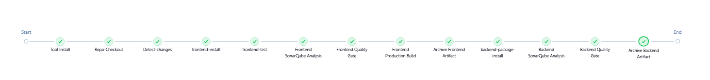
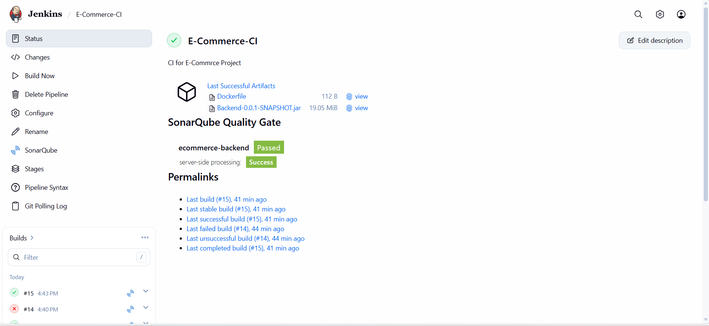
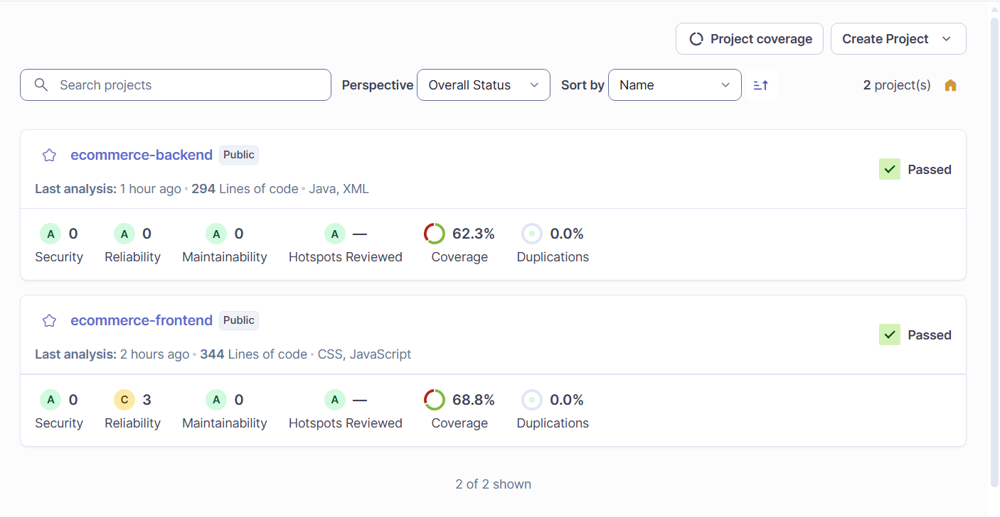

# Continuous Integration (CI) Pipeline — E-Commerce Application

## 1. Overview

This Continuous Integration (CI) pipeline automates building, unit testing, code coverage reporting, static code analysis, Quality Gate enforcement, and artifact packaging for the full-stack [E-Commerce Application](https://github.com/manojpandekamat/E-CommerceApp) monorepo (**React** frontend + **Spring Boot** backend).

### Key Pipeline Capabilities
* **Monorepo Path-Based Change Detection:** Uses `git diff --name-only` between `GIT_PREVIOUS_SUCCESSFUL_COMMIT` and `GIT_COMMIT` so `frontend/` changes only trigger React stages and `Backend/` changes only trigger Spring Boot stages—saving compute and build time.
* **Automated Testing & Coverage:** Runs Jest (`coverage/lcov.info`) for the frontend and JUnit + JaCoCo (`target/site/jacoco/jacoco.xml`) for the backend.
* **Enforced Quality Gates:** Integrates with a remote containerized SonarQube server using webhook callbacks (`/sonarqube-webhook/`) to abort the pipeline immediately if code quality or coverage thresholds fail.
* **Artifact Fingerprinting & Archiving:** Archives production-ready outputs (`frontend/build/**`, `Backend/target/*.jar`, and `Backend/Dockerfile`) for downstream Continuous Deployment (CD).

---

## 2. CI Tools, Credentials & Infrastructure Setup

### A. Credentials Required (`Manage Jenkins > Credentials > System > Global credentials`)

| Credential ID | Kind | Configuration Details |
| :--- | :--- | :--- |
| `github-credentials` | **Username with password** | GitHub username and Personal Access Token (PAT) with `repo` scope to clone `E-CommerceApp` and read `E-Commerce-Devops`. |
| `sonarqube-server` *(stored as Secret text)* | **Secret text** | Global Analysis Token (`squ_...`) generated in SonarQube under **My Account > Security**, linked to the `sonarqube-server` system entry. |

---

### B. Jenkins Global Tools (`Manage Jenkins > Tools`)

All build runtimes are managed declaratively in the `Jenkinsfile` `tools` block and installed automatically by Jenkins:

1. **JDK (`jdk21`):**
   * Navigate to **Manage Jenkins > Tools > JDK installations > Add JDK**.
   * Set **Name** to `jdk21`, check **Install automatically** (or point `JAVA_HOME` to your local JDK 21 installation), and save.
2. **Maven (`maven`):**
   * Navigate to **Maven installations > Add Maven**.
   * Set **Name** to `maven`, check **Install automatically** (Maven 3.9.x), and save.
3. **NodeJS (`nodejs24`):**
   * Requires the **NodeJS** plugin. Navigate to **NodeJS installations > Add NodeJS**.
   * Set **Name** to `nodejs24`, check **Install automatically**, select **NodeJS 24.x**, and save.
4. **SonarQube Scanner (`sonar`):**
   * Requires the **SonarQube Scanner** plugin. Navigate to **SonarQube Scanner installations > Add SonarQube Scanner**.
   * Set **Name** to `sonar`, check **Install automatically**, click **+ Add Installer > Install from Maven Central**, select **SonarScanner CLI 8.5+**, and save.

---

### C. Containerized SonarQube Server Setup (Remote AWS EC2)

SonarQube runs as a Docker container on a dedicated AWS EC2 instance (`http://<SONARQUBE_EC2_IP>:9000`):

```bash
# Launch containerized SonarQube on the remote EC2 instance
docker run -d \
  --name sonarqube \
  --restart unless-stopped \
  -p 9000:9000 \
  -v sonarqube_data:/opt/sonarqube/data \
  -v sonarqube_extensions:/opt/sonarqube/extensions \
  -v sonarqube_logs:/opt/sonarqube/logs \
  sonarqube:community
```

* **AWS Security Group:** Allow inbound TCP port `9000` from the Jenkins EC2 instance's IP address (and your admin IP for UI access).
* **SonarQube Projects:** Create two projects manually (or via auto-provisioning) matching the keys in `CI/Jenkinsfile`:
  * `ecommerce-frontend`
  * `ecommerce-backend`
* **Custom Quality profiles and quality gates configuration**: 
Configuring custom quality profiles, quality gates with the projects to apply custom rules and quality gates
* **Jenkins System Configuration (`Manage Jenkins > System > SonarQube servers`):**
  * Click **Add SonarQube**, set **Name** to `sonarqube-server`, set **Server URL** to `http://<SONARQUBE_EC2_IP>:9000`, and select your Secret text token under **Server authentication token**.

---

### D. SonarQube Webhook Configuration

To prevent `waitForQualityGate` from hanging until timeout, SonarQube must notify Jenkins once background analysis finishes:

1. In SonarQube, go to **Administration > Configuration > Webhooks > Create**.
2. Set **Name** to `Jenkins-Webhook`.
3. Set **URL** to `http://<JENKINS_EC2_IP>:8080/sonarqube-webhook/` *(ensure there is only a single `http://` prefix and a trailing slash)*.
4. In AWS EC2 Security Groups, ensure the **Jenkins EC2 instance** allows inbound TCP port `8080` from the **SonarQube EC2 instance IP**.

---

## 3. Jenkins Pipeline Stages & Architecture

### Architecture Diagram



### Stage-by-Stage Breakdown (`CI/Jenkinsfile`)

#### Global Pipeline Controls
* `skipDefaultCheckout(true)`: Disables automatic checkout of the DevOps repo into the build workspace so the `Repo-Checkout` stage can cleanly clone the application repository (`E-CommerceApp`).
* `when { expression { env.FRONTEND_CHANGED == 'true' } }` / `env.BACKEND_CHANGED == 'true'`: Conditionally executes only the modified stack's stages.

#### Core Initialization Stages
1. **`Repo-Checkout`:** Clones the `main` branch of `https://github.com/manojpandekamat/E-CommerceApp.git` using `github-credentials` and captures `GIT_COMMIT` and `GIT_PREVIOUS_SUCCESSFUL_COMMIT`.
2. **`Detect-changes`:**
   * If `GIT_PREVIOUS_SUCCESSFUL_COMMIT` is empty (first build), sets both `FRONTEND_CHANGED` and `BACKEND_CHANGED` to `'true'`.
   * Otherwise, runs `git diff --name-only <previousCommit> <currentCommit>` and checks if any changed file starts with `frontend/` or `Backend/`.

#### Frontend CI Stages (`Node.js 24`)
3. **`frontend-install`:** Runs `npm ci` inside `frontend/` for clean, reproducible dependency installation.
4. **`frontend-test`:** Runs `CI=true npm test -- --coverage --watchAll=false` to execute Jest unit tests and generate `coverage/lcov.info`.
5. **`Frontend SonarQube Analysis`:** Invokes `sonar-scanner` (`tool name: 'sonar'`) inside `withSonarQubeEnv('sonarqube-server')`, passing `-Dsonar.projectKey=ecommerce-frontend`, `-Dsonar.token=$SONAR_AUTH_TOKEN`, test inclusions (`**/*.test.js,**/*.test.jsx,**/*.test.ts,**/*.test.tsx`), and `coverage/lcov.info`.
6. **`Frontend Quality Gate`:** Pauses up to `10 MINUTES` (`timeout`) for `waitForQualityGate abortPipeline: true` to receive the SonarQube webhook verdict.
7. **`Frontend Production Build`:** Runs `npm run build` inside `frontend/` to generate optimized static assets.
8. **`Archive Frontend Artifact`:** Archives and fingerprints `frontend/build/**`.

#### Backend CI Stages (`JDK 21 + Maven`)
9. **`backend-package-install`:** Runs `mvn clean verify` inside `Backend/` to compile Java 21 code, run JUnit tests, and generate the JaCoCo coverage report (`target/site/jacoco/jacoco.xml`).
10. **`Backend SonarQube Analysis`:** Executes `mvn org.sonarsource.scanner.maven:sonar-maven-plugin:sonar` inside `withSonarQubeEnv('sonarqube-server')` with `-Dsonar.projectKey=ecommerce-backend` and `-Dsonar.coverage.jacoco.xmlReportPaths=target/site/jacoco/jacoco.xml`.
11. **`Backend Quality Gate`:** Waits up to `10 MINUTES` for `waitForQualityGate abortPipeline: true`.
12. **`Archive Backend Artifact`:** Archives and fingerprints `Backend/target/*.jar` and `Backend/Dockerfile`.

### Pipeline Execution & Verification Screenshots

#### Jenkins Pipeline Stage Overview


#### Jenkins Build Status & Archived Artifacts


#### SonarQube Quality Gate Results


---

## 4. Creating the Pipeline in Jenkins Dashboard (with 5-Minute SCM Polling)

Follow these steps to configure the E-Commerce-CI job in Jenkins and poll the application repository every 5 minutes:

1. **Create a New Pipeline Job:**
   * Open the Jenkins Dashboard and click **+ New Item**.
   * Enter item name `E-Commerce-CI`, select **Pipeline**, and click **OK**.
2. **Configure Build Triggers (Poll SCM Every 5 Minutes):**
   * Scroll to the **Triggers** section and check **Poll SCM**.
   * In the **Schedule** box, enter the 5-minute cron expression:
     ```cron
     H/5 * * * *
     ```
     *(Using `H/5` spreads the polling load evenly across the 5-minute window).*

3. **Configure Pipeline Script Manually:**
   * Scroll to the **Pipeline** section at the bottom.
   * Set **Definition** to **Pipeline script**.
   * Copy the entire contents of `CI/Jenkinsfile` from this repository and paste it directly into the **Script** editor box.
   * *(Note: Because the `Repo-Checkout` stage inside the script explicitly clones `E-CommerceApp.git`, Jenkins will still register the application repository for the 5-minute SCM polling after the first run.)*
4. **Save & Run Initial Build:**
   * Click **Save**, then click **Build Now** to trigger the initial baseline build and establish `GIT_PREVIOUS_SUCCESSFUL_COMMIT` for subsequent 5-minute SCM polls.
