# E-Commerce Application — DevOps & CI/CD Infrastructure

Centralized DevOps, Infrastructure-as-Code (IaC), and CI/CD pipelines for the full-stack **[E-Commerce Application](https://github.com/manojpandekamat/E-CommerceApp)** (**React** frontend + **Spring Boot** backend).

---

## Current Architecture (Phase 1: Continuous Integration)

> *Note: This diagram illustrates the active Continuous Integration (CI) workflow. The end-to-end architecture diagram will be updated once Continuous Deployment (CD) and Terraform infrastructure are added.*

---

## Repository Structure

| Directory / File | Status | Description & Documentation |
| :--- | :--- | :--- |
| **[`CI/`](./CI/README_CI.md)** | ✅ Completed | Declarative Jenkins CI pipeline (`CI/Jenkinsfile`) featuring monorepo `git diff` change detection, Jest & JaCoCo coverage, SonarQube Quality Gates, and artifact archiving. **[Read detailed CI documentation & setup guide →](./CI/README_CI.md)** |
| **`CD/`** | 🚧 Ongoing | Automated Docker image builds, container registry push, and rollout to AWS EC2 *(Phase 2)*. |
| **[`Terraform/`](./Terraform/)** | ✅ Completed | Infrastructure-as-Code provisioning AWS EC2 instances, VPC networking, and Security Groups *(Phase 3)*. |
| **[`images/`](./images/)** | ✅ Active | Architecture diagrams (`ci.svg`) and execution verification screenshots. |

---

## Key Engineering Highlights

* **Two-Repository Separation Strategy:** Isolates application source code ([`E-CommerceApp`](https://github.com/manojpandekamat/E-CommerceApp)) from pipeline definitions, infrastructure code, and operational docs (`E-Commerce-Devops`).
* **Smart Monorepo CI Optimization:** Compares `GIT_PREVIOUS_SUCCESSFUL_COMMIT` against `GIT_COMMIT` via `git diff --name-only` so `frontend/` and `Backend/` pipelines execute independently only when modified.
* **Automated Quality Gates:** Integrates a containerized SonarQube instance on AWS EC2 with Jenkins webhooks (`/sonarqube-webhook/`) to enforce test coverage (`lcov.info` & `jacoco.xml`) and custom quality profiles before packaging artifacts.

---

## Quick Navigation

* **Application Source Code:** [manojpandekamat/E-CommerceApp](https://github.com/manojpandekamat/E-CommerceApp)
* **CI Pipeline Logic, Tool Setup & Screenshots:** [`CI/README_CI.md`](./CI/README_CI.md)
* **Declarative CI Jenkinsfile:** [`CI/Jenkinsfile`](./CI/Jenkinsfile)
